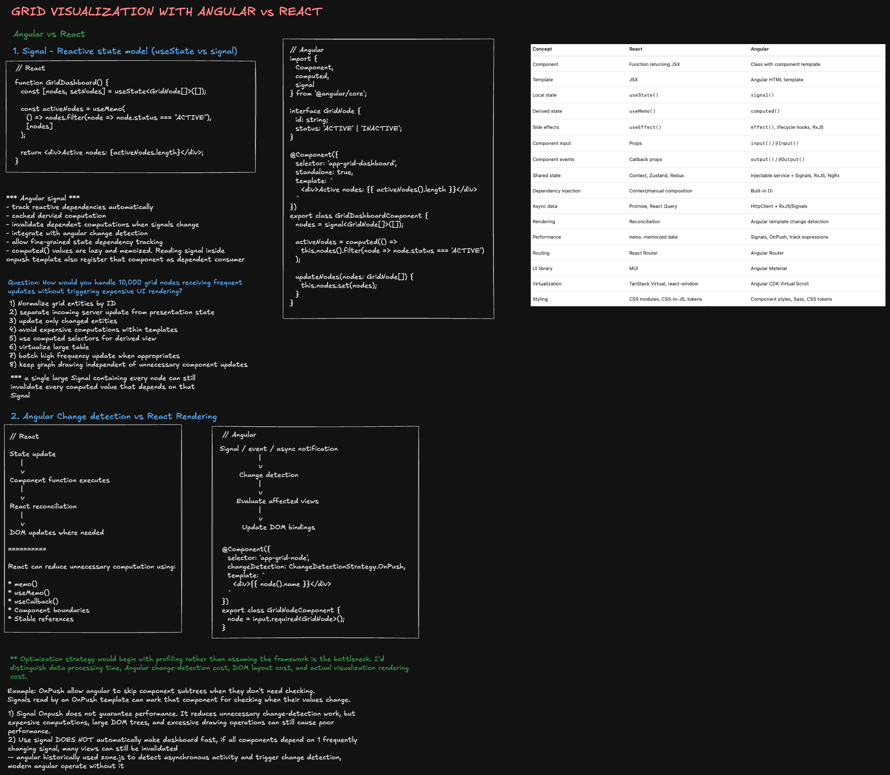

**Editable diagrams:**

- [Angular technique](https://excalidraw.com/#room=1c325a9b5a81ed812fe5,30xm7SBw5wbd60J19a-Xxw)
- [Feature design](https://excalidraw.com/#room=a4d3dff7d41f5eeef341,NP-o8KJ6W0YNb-GqjwdtJQ)




## Table of contents

1. [Interview framework and priorities](#1-interview-framework-and-priorities)
2. [React-to-Angular mental model](#2-react-to-angular-mental-model)
3. [Why 10,000 Angular components may be slow](#3-why-10000-angular-components-may-be-slow)
4. [React equivalents to Angular OnPush](#4-react-equivalents-to-angular-onpush)
5. [Large-scale grid dashboard architecture](#5-large-scale-grid-dashboard-architecture)
6. [WebSocket versus SSE](#6-websocket-versus-sse)
7. [Offline, disconnect, reconnect and reliable synchronization](#7-offline-disconnect-reconnect-and-reliable-synchronization)
8. [Data models and API contracts](#8-data-models-and-api-contracts)
9. [Performance, rendering and accessibility](#9-performance-rendering-and-accessibility)
10. [Angular Material, tokens and migration](#10-angular-material-tokens-and-migration)
11. [Failure testing and observability](#11-failure-testing-and-observability)
12. [Interview scripts and follow-ups](#12-interview-scripts-and-follow-ups)
13. [Five-day preparation plan and references](#13-five-day-preparation-plan-and-references)

---

## 1. Interview framework and priorities

The supplied Tapestry interview guide emphasizes L6+ depth (memory, concurrency, protocols), breadth (scalable system bottlenecks), Angular Material, design tokens, migration strategy, cross-team leadership, and pragmatic technical judgment.

### Highest-value preparation topics

| Priority | Subject                    | What to demonstrate                                                   |
| -------- | -------------------------- | --------------------------------------------------------------------- |
| Critical | Grid visualization         | React/Angular shell plus WebGL/Canvas rendering, viewports and LOD    |
| Critical | Angular internals          | Signals, OnPush, DI, RxJS, change detection                           |
| Critical | Design system              | Angular Material/CDK, semantic tokens, component contracts            |
| Critical | Streaming reliability      | Connection lifecycle, replay, snapshots, gap detection                |
| Critical | Performance                | JavaScript cost versus browser style/layout/paint, memory and workers |
| High     | Migration                  | Incremental adoption, compatibility layers, testing and rollout       |
| High     | Security and accessibility | AuthZ, sensitive caches, keyboard and nonvisual alternatives          |

### Reusable 60-minute design structure

| Time   | Discussion                                                             |
| ------ | ---------------------------------------------------------------------- |
| 0–7m   | Clarify use cases, consistency and freshness requirements              |
| 7–12m  | State architectural alternatives and tradeoffs early                   |
| 12–20m | Draw frontend and backend boundaries, transport and data flow          |
| 20–28m | Define entity model, API contracts and synchronization semantics       |
| 28–36m | Choose DOM/virtualization/Canvas/WebGL strategies                      |
| 36–50m | Deep dive into bottlenecks, failure recovery, correctness and security |
| 50–56m | Migration, testing, rollout, metrics and organizational adoption       |
| 56–60m | Summarize decisions, limitations, risks and next steps                 |

### Interview scoping questions

- Is this **monitoring-only**, or can operators issue commands that affect the grid?
- Are telemetry requirements _best-effort current state_ or _lossless history and alarms_?
- What is the maximum acceptable age of measurements per asset type?
- How many entities exist, how many are visible and what is the update rate?
- Are subscriptions static by region or frequently changed by pan/zoom?
- Must the app function offline, and may infrastructure data be persisted locally?
- Is event ordering guaranteed globally, per region, per partition or per asset?

Use illustrative numbers for practice, not as claims about Tapestry's deployed products: 100,000 assets, 10,000 visible nodes, 1-second telemetry, 7/30/90-day charts, and hundreds of concurrent operators.

---

## 2. React-to-Angular mental model

| Concept                  | React                       | Angular                         |
| ------------------------ | --------------------------- | ------------------------------- |
| Component                | Function + JSX              | Decorated class + template      |
| State                    | `useState`, `useReducer`    | `signal`                        |
| Derived value            | `useMemo`                   | `computed`                      |
| Side effects             | `useEffect`                 | `effect`, RxJS, lifecycle       |
| Input                    | Props                       | `input()` / `@Input()`          |
| Output                   | Callback props              | `output()` / `@Output()`        |
| Shared services          | Context / imported modules  | Dependency injection (`inject`) |
| Async transport          | Promises, query libs        | `HttpClient`, Observables, RxJS |
| Reduce child checks      | `memo`                      | `OnPush`                        |
| List identity            | `key`                       | `track` / `trackBy`             |
| Virtual list             | TanStack Virtual            | Angular CDK Scrolling           |
| Overlay/focus primitives | Portal / headless libraries | Angular CDK Overlay / A11y      |

### Angular Signals example

```ts
import { Component, computed, signal } from '@angular/core';

interface GridNode {
  id: string;
  status: 'ACTIVE' | 'INACTIVE';
}

@Component({
  selector: 'app-grid-dashboard',
  standalone: true,
  template: `<div>Active: {{ activeNodes().length }}</div>`,
})
export class GridDashboardComponent {
  readonly nodes = signal<GridNode[]>([]);
  readonly activeNodes = computed(() => this.nodes().filter((node) => node.status === 'ACTIVE'));
}
```

**Depth:** `computed` is dependency-tracked and memoized, but a single huge mutable conceptual dependency still causes broad invalidation if all consumers depend on it. Use explicit partitioning and selectors.

### OnPush and change detection

```ts
import { ChangeDetectionStrategy, Component, input } from '@angular/core';

@Component({
  selector: 'app-grid-node',
  standalone: true,
  changeDetection: ChangeDetectionStrategy.OnPush,
  template: `<div>{{ node().name }}: {{ node().voltage }}</div>`,
})
export class GridNodeComponent {
  readonly node = input.required<{ id: string; name: string; voltage: number }>();
}
```

OnPush lets Angular skip eligible subtrees, and Signal reads in templates participate in invalidation. It **does not** remove the cost of DOM nodes, layout or paint. Modern Angular also supports zoneless change detection; understand the historic role of Zone.js without assuming every current app uses it.

### RxJS operators to know

| Operator             | Typical decision                                                                    |
| -------------------- | ----------------------------------------------------------------------------------- |
| `switchMap`          | Latest search wins; unsubscribe from previous request/stream                        |
| `mergeMap`           | Concurrent independent operations                                                   |
| `concatMap`          | Preserve sequence of dependent actions                                              |
| `exhaustMap`         | Ignore repeated submit attempts while busy                                          |
| `debounceTime`       | Delay bursty input such as search                                                   |
| `combineLatest`      | Derive UI from multiple streams                                                     |
| `shareReplay`        | Share a source and retain recent emissions; configure lifecycle and cache carefully |
| `takeUntilDestroyed` | Tie subscription cleanup to Angular component lifecycle                             |

---

## 3. Why 10,000 Angular components may be slow

### Distinguish five costs

1. **Instantiation:** component objects, Angular runtime view state (`LView`; shared template metadata such as `TView`), bindings, event handlers and reactive subscriptions.
2. **Change detection:** template bindings and relevant view trees may be checked repeatedly; updates can fan out through broad state dependencies.
3. **DOM size:** 10,000 components generating five elements each create 50,000 or more DOM elements, even if Angular doesn't need to update them.
4. **Browser pipeline:** recalculating style, layout, paint and compositing can be expensive when many visual elements move or change.
5. **Memory/GC:** recreating 10,000 objects per telemetry tick, subscriptions and intermediate arrays produce allocation pressure and possible pauses.

```text
Incoming telemetry
      |
      v
Data normalization and allocations
      |
      v
Angular scheduling + view checks
      |
      v
DOM mutations (if needed)
      |
      v
Browser style -> layout -> paint -> composite
```

An illustrative estimate: 10,000 component checks \* 2 microseconds = 20 ms, already greater than a 16.7 ms budget for a 60 FPS frame. **This is not a benchmark**; profile real application hardware.

### Diagnose before optimizing

- Angular DevTools: expensive components, change detection.
- Chrome Performance: scripting, long tasks, style, layout, paint, interactions.
- Chrome Memory: heap growth, retained data, detached DOM.
- Frames/FPS: dropped frames during pan, zoom and telemetry bursts.

### Choose the right mitigation

| Bottleneck                 | Better solution                                             |
| -------------------------- | ----------------------------------------------------------- |
| Broad change detection     | OnPush, Signals, narrow selectors, stable entity references |
| Many list rows             | Angular CDK virtual scrolling                               |
| High-density topology map  | Canvas/WebGL instead of one Angular component per asset     |
| Heavy spatial calculations | Worker + spatial index                                      |
| Too many network updates   | Viewport subscriptions, batch/coalesce visualization events |
| Memory growth              | Bounded buffers/caches and subscription cleanup             |

---

## 4. React equivalents to Angular OnPush

**Closest analogy:** `React.memo` + immutable updates and stable props. It is not identical: memoized React components still render when their **own state** changes or when consumed **context** changes.

```tsx
import { memo, useCallback, useMemo, useState } from 'react';

type GridNode = { id: string; name: string; voltage: number };

const GridNodeCard = memo(function GridNodeCard({
  node,
  onSelect,
}: {
  node: GridNode;
  onSelect: (id: string) => void;
}) {
  return (
    <button onClick={() => onSelect(node.id)}>
      {node.name}: {node.voltage}
    </button>
  );
});

export function GridDashboard({ initialNodes }: { initialNodes: GridNode[] }) {
  const [nodes, setNodes] = useState(initialNodes);
  const [selectedId, setSelectedId] = useState<string | null>(null);

  const onSelect = useCallback((id: string) => setSelectedId(id), []);

  const activeNodes = useMemo(() => nodes.filter((node) => node.voltage > 200), [nodes]);

  function updateVoltage(id: string, voltage: number) {
    setNodes((prev) =>
      prev.map((node) => (node.id === id && node.voltage !== voltage ? { ...node, voltage } : node))
    );
  }

  return (
    <div>
      <p>Selected: {selectedId ?? 'none'}</p>
      {activeNodes.map((node) => (
        <GridNodeCard key={node.id} node={node} onSelect={onSelect} />
      ))}
      <button onClick={() => updateVoltage('A', 230)}>Update A</button>
    </div>
  );
}
```

**Why stable references matter:** in immutable updates, unchanged nodes reuse object references, so `memo` can skip their renders. Passing `{ ...node }` creates new references and defeats this. `useMemo` prevents recomputing expensive derived values **only while dependencies remain stable**.

### A more scalable approach: selective subscriptions

```tsx
import { create } from 'zustand';

type GridNode = { id: string; name: string; voltage: number };

type GridStore = {
  nodesById: Record<string, GridNode>;
  updateVoltage: (id: string, voltage: number) => void;
};

export const useGridStore = create<GridStore>((set) => ({
  nodesById: {},
  updateVoltage: (id, voltage) =>
    set((state) => {
      const old = state.nodesById[id];
      if (!old || old.voltage === voltage) return state;
      return {
        nodesById: {
          ...state.nodesById,
          [id]: { ...old, voltage },
        },
      };
    }),
}));

export function GridNodeCard({ nodeId }: { nodeId: string }) {
  const node = useGridStore((state) => state.nodesById[nodeId]);
  return node ? (
    <div>
      {node.name}: {node.voltage}
    </div>
  ) : null;
}
```

Only selectors whose results change should cause those components to render, although evaluating selectors and cloning large maps still has cost. Under high-frequency telemetry, consider partitioned stores or renderer-owned data buffers.

### Coalesce visual updates

```ts
const pending = new Map<string, number>();
let frameId: number | null = null;

export function enqueueVisualUpdate(
  id: string,
  voltage: number,
  applyBatch: (batch: Map<string, number>) => void
) {
  pending.set(id, voltage);
  if (frameId !== null) return;
  frameId = requestAnimationFrame(() => {
    frameId = null;
    const batch = new Map(pending);
    pending.clear();
    applyBatch(batch);
  });
}
```

**Do not use this coalescing mechanism to silently erase critical alerts, history, or audit records.** Separate durable event processing from latest-value visual projection.

React Compiler can automate some memoization in supported builds, but does not eliminate DOM, state architecture, or browser rendering costs.

---

## 5. Large-scale grid dashboard architecture

### User workflow

- Explore substations and transmission lines on a map.
- Filter by region/status and search assets.
- Select an asset for telemetry and history.
- Receive near-real-time values, quality indicators and alerts.
- Continue read-only exploration of authorized cached topology when offline.

### Design diagram

```text
                 Grid backend
            /          |          \
     Snapshot API   History API   Stream gateway
            \          |          /
             \         |         /
              Connection / sync coordinator
                         |
                 Sequence validation
                         |
                 Normalized entity store
                         |
            +------------+--------------+
            |            |              |
       IndexedDB      UI selectors   Draw buffers
            |            |              |
         Recovery   Angular/React      WebGL
                     controls/map UI    graph
```

### Rendering choice

| Surface                    | Best default                            |
| -------------------------- | --------------------------------------- |
| Controls, forms, tooltips  | Semantic DOM / Angular Material         |
| Data table                 | DOM with row virtualization             |
| Simple, modest charts      | SVG or chart library                    |
| Dense interactive topology | WebGL / Canvas with spatial hit-testing |
| Heavy layout, clustering   | Web Worker                              |

Use viewport culling, spatial cells, clustering/level of detail, and a spatial margin plus hysteresis so panning doesn't constantly unsubscribe/re-subscribe assets.

---

## 6. WebSocket versus SSE

**Decision rule:** Real-time data alone does not require WebSocket. Prefer SSE for mostly one-way server push; prefer WebSocket when the same persistent session requires frequent client-to-server messages or multiplexed, dynamic subscriptions.

| Question                       | SSE                                                | WebSocket                                      |
| ------------------------------ | -------------------------------------------------- | ---------------------------------------------- |
| Direction                      | Server to browser                                  | Two-way                                        |
| Transport                      | HTTP streaming                                     | WebSocket connection                           |
| Browser API                    | `EventSource`                                      | `WebSocket`                                    |
| Encoding                       | UTF-8 text events                                  | Text or binary frames                          |
| Browser reconnect              | Usually automatic for EventSource                  | Application implements retry                   |
| Event ID/resume                | Event IDs / Last-Event-ID; backend must replay     | App-defined cursor/resume                      |
| Dynamic viewport subscriptions | Often reopen stream / separate HTTP calls          | Send subscribe/unsubscribe on same connection  |
| Alerts + collaboration         | Possible with mixed HTTP flows                     | Natural bidirectional session                  |
| Proxy and scale                | HTTP-friendly, but proxy buffering/timeouts matter | Upgrade/long-lived connection support required |

### SSE example

```ts
const stream = new EventSource('/api/telemetry/stream?region=west');
stream.addEventListener('telemetry', (event) => {
  const parsed = JSON.parse((event as MessageEvent).data);
  validateAndApply(parsed);
});
stream.onerror = () => markStreamUnhealthy();
// On component/application teardown:
stream.close();
```

SSE event:

```text
id: region-west:1025
event: telemetry
data: {"nodeId":"A","voltage":230,"sequence":1025}
```

`Last-Event-ID` offers a resume mechanism; it **does not** guarantee retained replay or complete application state unless the server provides those contracts.

### WebSocket example messages

```json
{
  "type": "subscribe",
  "requestId": "req-123",
  "regionId": "west",
  "metrics": ["voltage", "frequency"]
}
```

```json
{ "type": "subscription_ack", "requestId": "req-123", "subscriptionId": "sub-456" }
```

```json
{
  "type": "telemetry_batch",
  "subscriptionId": "sub-456",
  "streamEpoch": "generation-7",
  "firstSequence": 1024,
  "updates": [
    { "nodeId": "A", "voltage": 230 },
    { "nodeId": "B", "voltage": 225 }
  ]
}
```

### Staff-level caveats

- Neither transport provides application-level **exactly-once processing**.
- Both require bounded queues and backpressure strategy.
- Network updates should be batched independently of whether the link is SSE or WebSocket.
- Browser WebSocket API does not expose protocol ping/pong frames; use app-level heartbeat messages if needed.
- Authorize individual subscriptions on the server, not only the initial connection.
- A hybrid of REST for snapshots/history and **one** streaming transport is often enough.

### Interview choice

> For a read-only monitor, I would initially choose SSE to minimize connection logic. If operators frequently change region subscriptions, need live collaboration, or send session-level messages, I'd select WebSocket. The critical scaling decision is to subscribe to visible spatial cells and avoid sending or rendering every asset globally.

---

## 7. Offline, disconnect, reconnect and reliable synchronization

### Core reliability invariant

> **Transport connected does not imply data synchronized, and last-known healthy equipment telemetry does not imply currently healthy equipment.**

### Separate transport and data status

```ts
type TransportStatus = 'CONNECTING' | 'CONNECTED' | 'DISCONNECTED';
type SyncStatus = 'INITIALIZING' | 'SYNCED' | 'STALE' | 'RECOVERING' | 'ERROR';
type DataQuality = 'CURRENT' | 'STALE' | 'MISSING' | 'RECOVERING';
type EquipmentStatus = 'HEALTHY' | 'WARNING' | 'CRITICAL' | 'UNKNOWN';
```

Possible state path:

```text
INITIALIZING -> SYNCED -> connection lost -> STALE
                                   |
                             RECONNECTING
                             /          \
                          retry       connected
                            |             |
                          OFFLINE      RECOVERING
                                           |
                              replay or snapshot
                                           |
                             validate continuity
                                           |
                                         SYNCED
```

### Three distinct failure signals

1. **Explicit close:** socket closes, network exception, auth failure.
2. **Silent transport failure:** connection looks open but heartbeat/expected traffic stops.
3. **Upstream sensor silence:** WebSocket and gateway are healthy, but a specific asset's samples are stale.

Tracking all three avoids incorrectly labeling an entire region as healthy just because the transport is open. `navigator.onLine` is only a weak hint and should not determine backend availability.

### Reconnect with exponential backoff and jitter

```ts
function reconnectDelay(attempt: number): number {
  const cap = Math.min(30_000, 1_000 * 2 ** attempt);
  return Math.random() * cap; // full jitter
}
```

Responsibilities of a centralized connection manager:

- Keep one shared transport per relevant session/region where practical.
- Detect heartbeats/timeouts and surface connectivity changes.
- Authenticate/re-authenticate and reauthorize subscriptions.
- Apply backoff and jitter to prevent a thundering herd.
- Unsubscribe and clean up when no consumers remain.
- Pass received events to a sync coordinator—not directly into UI components.

### Short outage: replay from checkpoint

```text
Client applied: 100, 101, 102
Disconnect
Backend produces: 103, 104, 105, 106
Reconnect
Client -> resume(streamId, epoch, afterSequence=102)
Backend -> 103, 104, 105, 106 + catch-up boundary
Client validates and applies in order
Client marks synchronized only once continuity is proven
```

A replay protocol must define ordering scope. A single integer cursor is only correct if the subscribed stream has a contiguous ordered sequence. Partitioned streams may need a **cursor per partition/region**.

### Long outage: authoritative snapshot

Fallback to a snapshot if replay retention expired, the stream epoch changed, or gaps cannot be filled.

```text
GET snapshot for region -> {entities, streamEpoch, snapshotCursor}
Open/resume stream strictly after snapshotCursor
Apply ordered tail events
Verify sync barrier; mark SYNCED
```

### Avoid the snapshot-to-stream race

**Bug:** Request snapshot, server generates it, more events occur, client opens stream too late and misses those events.

**Correct contract:** Snapshot has a server-defined cursor representing a consistent boundary, and the server promises to replay everything after it. Alternatively, subscribe and buffer events before loading a versioned snapshot, then reconcile against the snapshot cursor.

```text
GET /snapshot  <--- state through cursor 500
SUBSCRIBE after 500
EVENT 501
EVENT 502
EVENT 503
READY / caught-up barrier
```

**Important:** A WebSocket `open` event, or receiving a single telemetry event, is not proof of continuity. The server must provide a catch-up boundary/watermark or equivalent barrier.

### Duplicate and out-of-order handling

```ts
type TelemetryEvent = {
  nodeId: string;
  sequence: number; // ordered per node in this simplified example
  timestamp: number;
  voltage: number;
};

type NodeState = TelemetryEvent;

function applyTelemetry(current: NodeState | undefined, event: TelemetryEvent): NodeState {
  if (current && event.sequence <= current.sequence) return current;
  return { ...event };
}
```

This reducer ignores stale/duplicate events for the same node; **it does not prove gap-free delivery**. If event history matters, separately validate contiguous sequence numbers in the appropriate stream and replay missing events. Do not rely on device timestamps for total ordering.

### Replay without UI freezing

```text
Buffered/replayed events -> validate -> build latest state
                             |
                             +--> durable alerts / history separately
                             |
                             v
                   coalesced visual projection
                             |
                      batched store commits
                             |
                   Angular/React / WebGL view
```

A Worker can parse, index and aggregate historical events. Preserve durable alerts and audit-relevant transitions even if the visual display skips intermediate frames.

### Offline caching in IndexedDB

Cache only when security policy permits:

- Last-known authorized grid topology and metadata.
- Last-known measurements with **measurement timestamp, server version and cache timestamp**.
- Selected historical ranges under bounded retention.
- Resume checkpoints that can be tied safely to the persisted snapshot version.

Do **not** treat a persisted cursor as durable unless the state through that cursor was atomically persisted too. Otherwise, after browser restart the client might skip events not reflected in local state.

Do not cache raw access tokens. Scope caches by user/tenant and invalidate on logout, permission changes or auth changes. Sensitive infrastructure data may require memory-only operation instead.

### Operator-facing UX

| Transport    | Synchronization  | What the UI should say                          |
| ------------ | ---------------- | ----------------------------------------------- |
| Connected    | Synced, fresh    | `LIVE`                                          |
| Connected    | Replaying        | `Synchronizing — last-known data`               |
| Disconnected | Stale            | `Connection lost — values may be outdated`      |
| Connected    | One asset silent | Asset B: `STALE, last received 42 seconds ago`  |
| Offline      | Cached topology  | `Offline — cached view, not current grid state` |

Keep separate `equipmentStatus` and `dataQuality` fields. Include timestamps, text labels, keyboard support and appropriately restrained screen-reader announcements; color alone is insufficient.

### Offline actions

- **Monitoring-only:** allow cached exploration and local filters; disable server-confirmed actions.
- **Low-risk preferences:** queue selectively with idempotency keys, validation and visible pending state.
- **Operational grid-control commands:** never automatically queue and blindly replay after reconnect. Require current authoritative state, server-enforced authorization, precondition checks, explicit user confirmation and auditing.

---

## 8. Data models and API contracts

### Normalized models

```ts
type GridNode = {
  id: string;
  name: string;
  latitude: number;
  longitude: number;
  equipmentStatus: 'HEALTHY' | 'WARNING' | 'CRITICAL' | 'UNKNOWN';
};

type TelemetryMeasurement = {
  nodeId: string;
  voltage: number;
  current: number;
  frequency: number;
  measuredAt: number; // device/server measurement time
  receivedAt: number; // client observation time
  sequence: number; // per-node sequence in example
  quality: 'CURRENT' | 'STALE' | 'MISSING' | 'RECOVERING';
};

type SyncCheckpoint = {
  streamId: string;
  epoch: string;
  lastAppliedSequence: number;
};

type ClientState = {
  nodesById: Record<string, GridNode>;
  measurementsByNodeId: Record<string, TelemetryMeasurement>;
  checkpoints: Record<string, SyncCheckpoint>;
  transportStatus: 'CONNECTING' | 'CONNECTED' | 'DISCONNECTED';
  syncStatus: 'INITIALIZING' | 'SYNCED' | 'STALE' | 'RECOVERING' | 'ERROR';
};
```

### Example endpoints

```http
GET /api/grid/nodes?region=west
GET /api/grid/snapshot?region=west
GET /api/telemetry/history?nodeId=A&start=...&end=...&resolution=1m
GET /api/telemetry/stream?region=west
```

Example snapshot envelope:

```json
{
  "regionId": "west",
  "streamId": "region-west",
  "epoch": "generation-7",
  "snapshotCursor": 2050,
  "capturedAt": 1760000000000,
  "nodes": [{ "id": "A", "name": "Substation A", "latitude": 37.5, "longitude": -122.2 }],
  "measurements": [{ "nodeId": "A", "voltage": 230, "sequence": 2048, "measuredAt": 1760000000000 }]
}
```

The snapshot cursor represents the consistent **stream boundary** and need not equal each node's latest sequence. The API contract must define that distinction explicitly.

### Historical telemetry resolution

| Range    | Example server-side resolution |
| -------- | ------------------------------ |
| 1 hour   | 1 second                       |
| 24 hours | 1 minute                       |
| 7 days   | 5 minutes                      |
| 30 days  | 30 minutes                     |
| 90 days  | 1 hour                         |

Choose dynamically based on viewport width, zoom, metric type, anomaly retention and the significance of peaks. Preserve extrema and notable alarms; a naïve average can hide dangerous excursions.

---

## 9. Performance, rendering and accessibility

### Layered approach

- **Transport:** subscribe only to needed regions/entities; batch messages; bound queues.
- **Data:** normalize by ID, retain stable identities, avoid broad invalidation.
- **Scheduling:** process updates independent of paint cadence; `requestAnimationFrame` for visual commits.
- **Compute:** Worker for clustering/layout/aggregation; minimize transfer overhead.
- **Rendering:** DOM for controls; virtualized table for lists; WebGL/Canvas for dense graph.
- **Memory:** bounded histories and cache eviction; don't keep every tick in React/Angular component state.

### Frame-time reasoning

At 60 FPS there are about 16.7 ms per frame _for all work combined_, not just change detection. Heavy tasks can delay keyboard, pointer and accessibility interactions. Optimize using real profiles instead of assuming the framework is the limiting factor.

### Accessibility for graph visualization

Provide a synchronized alternative data table, accessible detail panel, clear labels for status and staleness, keyboard operation where feasible, and predictable focus transitions. Avoid relying solely on the canvas/WebGL surface for critical information.

---

## 10. Angular Material, tokens and migration

### Three-layer component architecture

```text
Product apps (GridAware, Analytics, Operations)
           |
Domain components (GridNodeCard, TopologyViewer, TelemetryChart)
           |
UI primitives (Angular Material/CDK, Table, Dialog, Input, Overlay)
           |
Tokens (foundation -> semantic -> component)
```

Tokens:

```css
:root {
  --status-critical: #b3261e;
  --status-warning: #8a5a00;
  --surface-default: #fff;
  --space-md: 16px;
  --table-row-hover: #eef3f8;
}
```

Validate color/contrast in all themes; real operational indicators also need non-color signals.

### Staff-level migration plan

1. Inventory Angular versions, NgModules/standalone components, current Material usage, state patterns, performance and accessibility baselines.
2. Establish stable component contracts, tokens, testing and documented contribution rules.
3. Migrate low-risk buttons, inputs, menus, dialogs, then grids/charts and domain features.
4. Add compatibility adapters, visual regression tests, telemetry and phased rollout.
5. Deprecate and remove duplicate components once adoption is verified.

Never start with a rewrite unless evidence demonstrates incremental migration is materially worse. Measure adoption, performance, accessibility and developer efficiency—not component count alone.

---

## 11. Failure testing and observability

| Failure injection                   | Expected result                                          |
| ----------------------------------- | -------------------------------------------------------- |
| Disconnect for 5 seconds            | Mark stale; retry; replay from checkpoint                |
| Disconnect for hours                | Replay if retained; otherwise consistent snapshot        |
| Duplicate event                     | Ignore duplicate; maintain idempotence                   |
| Out-of-order event                  | Preserve newer state; detect gaps where required         |
| Backend restarts/epoch changes      | Invalidate checkpoint; resnapshot                        |
| WebSocket open but no asset updates | Mark only affected assets stale                          |
| Browser tab suspended/resumed       | Revalidate transport and freshness                       |
| Rapid region changes                | Prevent outdated subscription responses from taking over |
| Authentication expires              | Suspend access and recover under fresh auth              |
| Replay of 100,000 events            | Rebuild state without blocking interactions              |
| Permission/user changes             | Prevent cross-user cached data exposure                  |

Track: reconnect success, time-to-synced, event gaps, snapshots required, stale-measurement percentage, main-thread blocking, dropped frames, heap growth, unauthorized subscription attempts and replay lag.

---

## 12. Interview scripts and follow-ups

### A. Why not 10,000 Angular components? (60–90 seconds)

> I'd examine three layers: Angular view/runtime overhead, browser DOM/rendering cost, and memory/data-processing overhead. OnPush and Signals can reduce unnecessary view checks, but they don't eliminate the underlying DOM and paint work. For a list, I'd virtualize; for dense topology, I'd use Angular for controls and Canvas/WebGL for drawing. I'd normalize state, batch visual updates and profile change detection versus layout/paint before choosing where to optimize.

### B. React equivalent of OnPush (60–90 seconds)

> The closest React equivalent is `React.memo` combined with immutable updates and stable props. Unchanged entity references let memoized children skip renders, while `useMemo` caches derived computation and `useCallback` stabilizes callback props. At dashboard scale, I'd go beyond memoization by using fine-grained subscriptions per entity, batching incoming telemetry and avoiding thousands of DOM-backed React components for dense graphics.

### C. Why WebSocket instead of SSE? (90 seconds)

> I'd start with the communication pattern. If the user only consumes server-pushed telemetry, SSE is simpler and its browser API handles reconnection. If operators frequently change viewport subscriptions or need collaboration/session messages, I prefer WebSocket for bidirectional multiplexing over one persistent connection. Neither choice solves consistency or rendering by itself. I'd use REST for versioned snapshots/history, a transport manager for the live feed and server-side viewport filtering.

### D. Offline/disconnect/reconnect and reliable data (about 2 minutes)

> I'd separate transport status from synchronization status, because reconnecting doesn't prove the dashboard is current. When the stream becomes unhealthy, the UI marks affected data stale and preserves last-known readings with timestamps. The connection manager retries with jitter, while a sync coordinator resumes from an acknowledged checkpoint. For short gaps it replays ordered events; for a missing or expired replay range it requests an authoritative snapshot and resumes after a consistent snapshot cursor. Sequence checks prevent stale/duplicate events from overwriting newer state, and a server-provided catch-up barrier confirms continuity. I would batch rendering during replay, while retaining critical alert history. Offline topology may be read-only cached if policy permits; I would not queue grid-control commands for automatic execution after reconnect.

### E. Follow-up: 100,000 assets, 2,000 visible

> Partition subscriptions into spatial cells, subscribe to the visible region plus an overscan margin, and use hysteresis to avoid churn during small pans. Zoomed-out views receive aggregates; zoomed-in views receive raw telemetry. Keep alert delivery separate from visual sampling, and define ordering/replay guarantees per region or stream partition.

### Additional questions worth rehearsing

- What contract proves the snapshot and subsequent stream events have no gap?
- What if the server replays duplicates after connection recovery?
- How do you distinguish gateway connectivity from individual sensor freshness?
- How do you avoid 10,000 tabs/clients reconnecting at the same instant?
- What if a user's authorization changes while offline?
- Why is an optimistic queued grid-control command potentially unsafe?
- When would IndexedDB be disallowed even though offline navigation is requested?
- How do you ensure downsampling doesn't hide dangerous maximum values?

---

## 13. Five-day preparation plan and references

| Day | Focus                                | Practice output                                               |
| --- | ------------------------------------ | ------------------------------------------------------------- |
| 1   | Angular Signals, OnPush, DI, RxJS    | Small telemetry list/detail app                               |
| 2   | Angular Material, CDK, design tokens | Reusable table/dropdown + token scheme                        |
| 3   | Grid rendering                       | Architecture for 10k visible / 100k total assets              |
| 4   | Streaming correctness                | Failure-state machine, replay and snapshot protocol           |
| 5   | L6 mock                              | 60-minute design with tradeoffs, follow-ups and STAR examples |

Useful official references:

- [Angular Signals](https://angular.dev/guide/signals)
- [Angular OnPush and skipping subtrees](https://angular.dev/best-practices/skipping-subtrees)
- [Angular Material](https://material.angular.dev/)
- [Angular CDK](https://material.angular.dev/cdk/categories)
- [RxJS](https://rxjs.dev/)
- [React memo](https://react.dev/reference/react/memo)
- [MDN WebSocket](https://developer.mozilla.org/en-US/docs/Web/API/WebSocket)
- [MDN Server-sent events](https://developer.mozilla.org/en-US/docs/Web/API/Server-sent_events)
- [MDN IndexedDB](https://developer.mozilla.org/en-US/docs/Web/API/IndexedDB_API)

---

## Final Staff-level principles

1. **Transport recovered does not equal data recovered.**
2. **Last-known measurements do not equal real-time measurements.**
3. **Reliable event processing does not require rendering every event.**
4. **OnPush/memoization do not solve an oversized DOM.**
5. **Choose transport by communication needs, not by whether the product is called real-time.**
6. **Optimize the architecture around visibility, freshness, correctness, and operator trust.**
